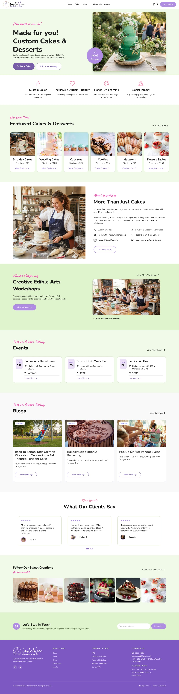

# TasteNsee WordPress Site

This repository contains the `wp-content` directory for the TasteNsee website: a custom WordPress theme, site-specific must-use plugins, and installed plugins. WordPress core, database content, and uploaded media are separate from the theme source.

## Homepage preview



## Local setup

1. Start the site in Local (or another WordPress development environment).
2. Place this content in the site's `wp-content` directory.
3. Activate **Taste N See** under **Appearance → Themes**.
4. Keep all three `mu-plugins/tastensee-*.php` files installed. WordPress loads these automatically; they register Cakes, Testimonials, and Pop-Up Markets.
5. Create WordPress Pages with the slugs needed by the page templates below. Configure the homepage under **Settings → Reading**.
6. Set **Settings → General → Timezone** to `America/Edmonton` for Calgary event dates.
7. Save **Settings → Permalinks** if custom content URLs return a 404 after moving the site.

The theme uses PHP, CSS, and JavaScript directly; there is no theme build step. Fonts, Remix Icon, and Swiper are loaded from external services in `functions.php`.

## Main files

All theme paths below are relative to `themes/tastensee-theme/`.

| File | Purpose |
| --- | --- |
| `front-page.php` | Homepage, including featured cakes and upcoming markets |
| `header.php` | Shared header and main navigation |
| `footer.php` | Shared footer |
| `functions.php` | Theme support and stylesheet/script loading |
| `style.css` | Theme metadata, styles, design variables, and responsive layouts |
| `scripts/script.js` | Frontend interactions |
| `assets/` | Theme images, icons, and other static assets |
| `template-parts/popup-card.php` | Shared market card for upcoming and past listings |

## Pages and routes

| URL | Template |
| --- | --- |
| `/` | `front-page.php` |
| `/about/` | `page-about.php` |
| `/contact/` | `page-contact.php` |
| `/inquire/` | `page-inquire.php` |
| `/thank-you/` | `page-thank-you.php` |
| `/workshops-events/` | `page-workshops-events.php` |
| `/past-events/` | `page-past-events.php` |
| `/pop-up-markets/{slug}/` | `single-popup.php` |
| `/cakes/` | `archive-cake.php` |
| `/testimonials/` | `archive-testimonial.php`, which loads `archive-testimonials.php` |

Page templates require a corresponding published WordPress Page. Cakes and Testimonials use custom post type archives. Pop-Up Markets use individual post URLs and page-based listings.

## Managing content

### Cakes

Manage cakes under **Cakes** in WordPress. Set a title, featured image, category, and Order value. Select **Featured on homepage** to include a cake in the homepage gallery.

### Testimonials

Manage reviews under **Testimonials**. Use the title for the client name and the editor for the quote. Set the client photo, category, star rating, and Order as needed.

### Pop-Up Markets

Manage markets under **Pop-Up Markets**. Enter the title, description, optional excerpt, and featured image. The ACF **Market Details** group supplies these fields:

- `popup_date`: event date, stored as `Ymd`.
- `popup_start_time`: start time, stored as `H:i:s`.
- `popup_end_time`: end time, stored as `H:i:s`.
- `popup_location`: location text.

Keep field names and keys stable. The field group is managed in the database; export and import it through **ACF → Tools** when moving environments.

Published markets dated today or later appear in the upcoming listing. Earlier dates appear in the past listing automatically, using the WordPress site timezone. Both lists sort by event date descending. Markets without an event date do not appear in these listings.

The Workshops & Events page also contains hardcoded workshop content. Edit that content in `page-workshops-events.php`.

### Forms

The Contact and Inquire templates embed Contact Form 7 shortcodes. Verify the form IDs, mail settings, and submission behavior after importing the database or moving the site.

## Navigation and styling

The main menu is written in `header.php`. The Workshop & Events link uses `site-header__nav-link--active` on the workshops listing, past-events pages, and individual `popup` posts.

The divider between Pop-Up Markets and Past Events & Workshops is styled through `.workshops-events-listings #past-workshops::before` in `style.css`, with responsive positioning for mobile.

Use WordPress helpers for URLs:

```php
" alt="Description" />
<a href="<?php echo esc_url( home_url( '/workshops-events/' ) ); ?>">Workshops &amp; Events</a>
```

Some workshop links still use `.html` destinations. Update these when their WordPress pages or registration destinations are ready.

## Checking changes

- Run `php -l path/to/changed-file.php` for changed PHP templates. In Local, open the site's shell if PHP is unavailable in your normal terminal.
- Run `git diff --check` to check patch whitespace.
- Review the affected page at desktop and mobile widths. For menu changes, check both the current section and an unrelated page.
- For event changes, check upcoming, past, single-event, and empty-list states.

When deploying, include the custom theme and must-use plugins, migrate the required database content and ACF field group, and transfer uploaded media separately. `/uploads/` is excluded from Git.
